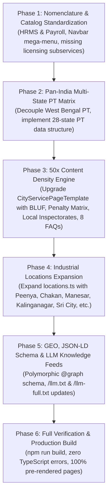

# SERVICE DIAL TALENT MANAGEMENT PVT LTD
## PAN-INDIA ENTERPRISE EXPANSION & 50X CONTENT DEPTH BLUEPRINT
**CIN:** U74999WB2016PTC216954  
**Benchmark Reference:** Mynd Solutions (myndsolutions.com / MYNDX), Quess Corp, TeamLease Services, ADP India  
**Target Search Optimization:** Generative Engine Optimization (GEO), AI Search (Perplexity, Google SGE/AIO, Claude), Multi-State Programmatic SEO (pSEO)  
**Date:** November 14, 2026  
**Status:** Comprehensive Architectural Master Blueprint  

---

## EXECUTIVE SUMMARY & STRATEGIC MANDATE

Service Dial Talent Management Private Limited is positioning itself as India's premier enterprise managed services provider across **Virtual CMA / Finance & Accounts Department**, **HRMS & Payroll**, **Statutory Labour Law Compliance**, **Flexi-Staffing & Recruitment**, and **MSME / Factory / Municipal Licensing**.

This master blueprint consolidates research conducted by a dedicated fleet of 6 specialized autonomous subagents to achieve three strategic imperatives:
1. **Pillars & Nomenclature Standardization:** Standardize "Payroll" to **"HRMS & Payroll"** across all touchpoints, eliminate misleading statutory IP fee calculators, and elevate Compliance to prominently feature PF, ESIC, Shop & Establishment, CLRA, Factory Licensing, Trade Licensing, and SPCB Environmental Consents.
2. **Pan-India Decoupling & Multi-State Expansion:** Eliminate single-state regional biases (such as excessive focus on West Bengal PT) and deploy a unified **Pan-India Statutory Matrix** covering all 28 States and 8 UTs, with immediate deep coverage across Tier-1, Tier-2, and Tier-3 commercial and industrial manufacturing corridors.
3. **50x Content Density & Anti-Thin Content Engine:** Overhaul thin programmatic pages with verified statutory acts, section citations, penalty clauses, local DISH/Labour Directorate jurisdictions, and rich localized technical FAQs that serve as primary citation targets for AI search engines (GEO/AIO).

---

## 1. ENTERPRISE COMPETITIVE BENCHMARK (MYND SOLUTIONS & MARKET LEADERS)

### 1.1 Competitive Positioning Matrix

| Dimension | Mynd Solutions (MYNDX) | TeamLease (RegTech) | Quess Corp (Allsec/Simpliance) | Service Dial Target Architecture |
|---|---|---|---|---|
| **Core Moat** | P2P / AP Automation, Fixed Asset Verification (CARO 2020), TReDS (M1xchange) | 70,000+ Regulatory compliance tracking SaaS | Sheer headcount scale (>500k deployed associates) | Integrated Virtual CMA + HRMS & Payroll + Plant Licensing + Flexi-Staffing with Legal Indemnity |
| **Accounts Dept** | 3-Way invoice match, GSTR-2B ITC reconciliation, MSME 43B(h) gatekeeper | Advisory only | Transaction processing via BPM | Full Virtual Accounts Dept: AP, AR, R2R, Cost Audit (Sec 148), CARO 2020 Asset Tagging |
| **HRMS & Payroll** | Qandle HRMS + Managed Payroll | Digital payroll + EOR staffing | Allsec SmartHR enterprise engine | Proprietary Cloud HRMS, 99.98% Gross-to-Net accuracy, Air-Gapped CXO Shadow Payroll |
| **Licensing** | Vendor compliance auditing | Pan-India statutory filing desk | Regional facility liaison | Tier-1 to Tier-3 Municipal Trade Licenses, S&E Dual-Tier, Factories Act Form 1/2, SPCB CTE/CTO, Fire NOC |

### 1.2 Virtual Accounts Department Workflow Engine
* **Procure-to-Pay (P2P):** Automated 3-way matching (PO vs GRN/SES vs Tax Invoice) with real-time Rule 37A & Section 16(4) GSTR-2B Input Tax Credit reconciliation.
* **MSME Section 43B(h) Gatekeeper:** Automated tracking of vendor Udyam classification; 15-day (unwritten) and 45-day (written) payment queues to prevent corporate income tax expenditure disallowance; automated Section 16 penal interest accrual at 3x RBI Bank Rate; API gateway to RBI TReDS platforms (M1xchange).
* **CARO 2020 Clause 3(i) Fixed Asset Tagging:** Physical floor-to-sheet and sheet-to-floor reconciliation eliminating "ghost assets"; anodized aluminum barcode and UHF passive RFID tagging (865–867 MHz) for heavy industrial plants.
* **CARO 2020 Clause 3(ii) Inventory Audit:** Quarterly bank drawing power (DP) verification for sanctioned working capital limits > ₹5 Crore; variance reporting > 10% under Ind AS 2.
* **Section 148 Cost Audit & IFC-FR:** Maintenance of cost records (Form CRA-1), cost audit compliance (Form CRA-2/3/4) for turnover > ₹35Cr/₹100Cr, and Risk Control Matrices (RCM) under Section 134(5)(e).

---

## 2. PAN-INDIA MULTI-STATE STATUTORY MATRIX

### 2.1 Multi-State Professional Tax (PT) Statutory Slabs

| State | Governing Act | Slabs & Rates | Special Rules / Gender Nuance | Portal |
|---|---|---|---|---|
| **Karnataka** | Karnataka Tax on Professions Act, 1976 *(2023 Amendment)* | • Up to ₹24,999: **Nil** • ₹25,000 & above: **₹200/mo** *(₹2,400/yr)* | Threshold raised from ₹15k to ₹25k; PTEC ₹2,500/yr | **e-Prerana** (`pt.kar.nic.in`) |
| **Maharashtra** | Maharashtra State Tax on Professions Act, 1975 *(2023 Amendment)* | **Men:** ≤₹7.5k: Nil; ₹7.5k–₹10k: ₹175; >₹10k: ₹200 (Feb: ₹300) **Women:** ≤₹25,000: **Nil**; >₹25,000: ₹200 (Feb: ₹300) | Full exemption for women earning up to ₹25,000/mo | **Mahagst** (`mahagst.gov.in`) |
| **Gujarat** | Gujarat State Tax on Professions Act, 1976 *(2022 Amendment)* | • Up to ₹12,000: **Nil** • > ₹12,000: **₹200/mo** *(₹2,400/yr)* | Multi-tier lower brackets removed | Commercial Tax Gujarat / AMC / SMC |
| **Tamil Nadu** | TN Municipal Laws (Collection of Tax on Professions) Rules, 1998 | Half-Yearly: ≤₹21k: Nil; ₹21k–₹30k: ₹180; ₹30k–₹45k: ₹430; ₹45k–₹60k: ₹930; ₹60k–₹75k: ₹1,025; >₹75k: ₹1,250 | Assessed and deducted half-yearly (August & January) | Greater Chennai Corp / ULB Portals |
| **Telangana** | Telangana Tax on Professions Act, 1987 | • Up to ₹15,000: **Nil** • ₹15,001–₹20,000: **₹150/mo** • > ₹20,000: **₹200/mo** | Flat ₹200/mo, no February spike; annual cap ₹2,400 | **TGCT** (`tgct.gov.in`) |
| **Odisha** | **REPEALED** *(Repeal Ordinance/Act 2026, eff. 01-Apr-2026)* | **NIL** *(Statute formally abolished statewide)* | Zero ongoing PT deduction; massive marketing differentiator | Odisha Treasury (`odishatax.gov.in`) |
| **West Bengal** | WB State Tax on Professions Act, 1979 *(Notif. 1607-F.T., eff. 01-Oct-2026)* | • Up to ₹20,000: **Nil** • ₹20k–₹30k: ₹100; ₹30k–₹50k: ₹140; ₹50k–₹1L: ₹170; >₹1L: ₹208 | Exemption doubled from ₹10k to ₹20k; annual cap ₹2,496 | **GRIPS** (`wbprofessiontax.gov.in`) |
| **Madhya Pradesh** | MP Vritti Kar Adhiniyam, 1995 | Annual: ≤₹2.25L: Nil; ₹2.25L–₹3L: ₹1,500; ₹3L–₹4L: ₹2,000; >₹4L: ₹2,500 | Assessed annually, deducted monthly | **MP e-Tax** (`mptax.mp.gov.in`) |
| **Nil PT States** | *Delhi, Haryana, Rajasthan, Uttar Pradesh, Punjab (only income-tax assessees @ ₹200/mo), Goa, Bihar, Jharkhand* | **₹0 (No Professional Tax)** | Critical for Gurugram, Noida, Delhi, Faridabad, Jaipur | Respective state LWF applies |

### 2.2 Shops & Commercial Establishments Dual-Tier Framework
* **Establishments with <10 Workers (Simplified Intimation):**
  * Online self-intimation (Form F in Maharashtra, Form D in Gujarat, Form A instant in Delhi).
  * Lifetime validity with zero periodic renewal fees.
  * Statutory protection against routine labour inspector visits without prior written sanction of Joint Commissioner.
* **Establishments with 10+ Workers (Full Registration):**
  * Formal Certificate of Registration (Form B in MH/GJ, Form C in KA/DL/TN).
  * Mandated statutory registers: Form A (Employee Register), Form B (Wage Register), Form Q (Employment Register), Form R (Annual Return).
  * Overtime caps: Twice ordinary wages (2x), capped at 50 to 125 hours per quarter.
  * Female night shift protections: Mandatory written consent, GPS-tracked transportation with security escorts, CCTV coverage, and active POSH Internal Committee (IC).

### 2.3 Factories Act 1948 State Amendments & Industrial Lifecycle
* **Section 2(m) Doubled Thresholds:** Maharashtra (2015), Gujarat (2020), Rajasthan (2014), and Haryana (2020) doubled the factory definition threshold to **20 workers with power** and **40 workers without power**.
* **4-Stage Industrial Plant Licensing Lifecycle:**
  1. *Site Plan Approval (Section 6 & Form 1):* Structural drawings, material handling, ventilation, and Form 1-A stability certificate signed by DISH-recognized competent person.
  2. *License Grant & Registration (Form 2):* Notice of occupation, worker headcount, horsepower calculation, fee payment, and issuance of Form 4 factory license.
  3. *Statutory Workplace Notices:* Form 11 (Notice of periods of work), Form 12 (Adult worker register), Form 18 (Notice of accident within 24h).
  4. *Annual Returns & Renewals:* Form 21/22 annual return; 5 to 15-year multi-year renewals.
* **Mandatory Safety Infrastructure:**
  * Safety Officer (Section 40-B): Mandatory for 1,000+ workers (500+ in hazardous chemical/metallurgical units; 250+ in MH & GJ).
  * Welfare Officer (Section 49): Mandatory for 500+ workers.
  * Canteen (Section 46): Mandatory for 250+ workers.
  * Crèche (Section 48): Mandatory for 30+ women workers.

### 2.4 Municipal Trade Licenses & Health Permits
* **BBMP (Bengaluru):** Section 305 BBMP Act 2020; calculated on carpet area and machinery HP; renewal by Feb 28; severe late fines up to 5x.
* **BMC / MCGM (Mumbai):** Section 394 read with Schedule M of MMC Act 1888; Senior Inspector of Licenses; court prosecution under Section 471/472 and premises sealing under Section 394(4).
* **GHMC (Hyderabad):** Section 521 GHMC Act 1955; road-width based pricing (₹3 to ₹6/sq ft); online TIN generation via TS-bPASS.
* **MCD (Delhi):** Section 417 DMC Act 1957; colony categories A to H; General Trade, Health Trade, and Storage licenses.
* **GCC (Chennai):** Section 287 CCMC Act 1919; Dangerous & Offensive (D&O) trades.
* **Other Major Municipal Bodies:** KMC (Kolkata Sec 199 Certificate of Enlistment), PMC (Pune Sec 376), AMC (Ahmedabad GPMC Sec 376), BMC (Bhubaneswar Sujog portal), MCG (Gurugram).

### 2.5 Environmental (SPCB) & Fire Safety Governance
* **CPCB Categorization:** Red ($PI \ge 60$), Orange ($PI = 41–59$), Green ($PI = 21–40$), and White ($PI \le 20$ - completely exempt from CTE/CTO).
* **Consent to Establish (CTE) & Consent to Operate (CTO):** Sections 25/26 Water Act 1974 & Section 21 Air Act 1981; effluent parameters (BOD, COD, TSS), stack height equations ($H = 14 \times Q^{0.3}$), and Hazardous Waste Form 1/Form 3 manifests.
* **Fire NOCs (NBC 2016 Part 4):** Provisional Fire NOC (setbacks, 6m perimeter road, staircase widths) -> Active installation (2,850 LPM pumps, 100kL underground tank, wet risers, sprinklers) -> Final Fire Safety Certificate (FSC) -> Bi-annual Form B maintenance certificates.

### 2.6 Contract Labour (CLRA 1970) Principal Employer Shield
* **Principal Employer Registration:** Form I application -> Form II Certificate of Registration.
* **Contractor Licensing:** Form V certificate issued by Principal Employer -> Form IV application by contractor -> Form VI license.
* **Zero Co-Employment Audit:** Monthly verification of matched EPFO ECRs, ESIC challans, minimum wage parity, and Form XIX wage slips before invoice clearance; strictly establishing "Contract for Service" (deliverable-based) rather than "Contract of Service" (supervision-based).

---

## 3. PAN-INDIA INDUSTRIAL ENGINES & EXPANSION HUBS

To deliver comprehensive enterprise coverage across India, the location architecture in `src/data/locations.ts` expands to include the following manufacturing and commercial engines:

1. **Karnataka:** Bengaluru, Peenya MSME Industrial Area, Whitefield EPIP, Electronic City, Bommasandra-Jigani, Bidadi Auto Zone, Mysuru, Hubballi-Dharwad.
2. **Maharashtra:** Mumbai, Pune (PCMC/Bhosari), Chakan-Talegaon Auto Belt, Ranjangaon, TTC Navi Mumbai, Taloja Chemical MIDC, Chhatrapati Sambhajinagar (AURIC), Nagpur (Butibori/MIHAN), Nashik.
3. **Tamil Nadu:** Chennai, Sriperumbudur-Oragadam (Auto & Electronics Corridor), Ambattur, Hosur SIPCOT (EV & Engineering), Coimbatore (Pumps & Foundries), Tiruppur (Knitwear).
4. **Gujarat:** Ahmedabad, Sanand (Auto & Semiconductor GIDC), Changodar, Vadodara (Makarpura/Savli), Dahej-Bharuch PCPIR, Surat (Hazira Heavy Complex), Morbi (Ceramics), Rajkot (Forgings).
5. **Odisha:** Bhubaneswar, Kalinganagar Steel Belt (Jajpur), Jharsuguda-Rourkela (Aluminum & Steel), Paradeep Port PCPIR.
6. **Haryana / Delhi NCR:** Delhi (Okhla/Bawana), Gurugram (Udyog Vihar), IMT Manesar Auto Corridor, IMT Bawal (Japanese Zone), Faridabad.
7. **Rajasthan:** Jaipur (Sitapura/VKIA), Bhiwadi (Auto & Glass), Neemrana (Japanese Zone).
8. **Madhya Pradesh:** Indore, Pithampur Auto & Pharma SEZ, Dewas, Bhopal (Mandideep).
9. **Punjab:** Ludhiana (Bicycle & Hosiery Engine), Jalandhar, Mandi Gobindgarh (Steel Town).
10. **Andhra Pradesh:** Visakhapatnam (Steel, Port & Pharma City), Sri City (Multi-Product SEZ), Kakinada.
11. **Uttar Pradesh:** Noida, Greater Noida (Electronics & Data Centers), Kanpur (Leather & Defense).
12. **West Bengal:** Kolkata, Howrah (Foundry & Heavy Engineering), Haldia (Port & Petrochem), Asansol-Durgapur.

---

## 4. 50X CONTENT DENSITY & ANTI-THIN CONTENT ENGINE

### 4.1 Programmatic Content Density Upgrade
The upgraded `CityServicePageTemplate.tsx` injects four deep statutory modules, expanding dynamic page length from ~450 words to 2,500+ words:
1. **BLUF Direct Answer Card (Top 400px):** Immediate statutory mandate, penalty consequence, Service Dial SLA, and regulatory act citations.
2. **Statutory Non-Compliance Penalty Matrix:** High-contrast tabular breakdown detailing Specific Violation, Governing Statute, Financial Penalty Surcharge, Criminal Prosecution Clauses, and Cognizance Authorities.
3. **Local Inspectorate & Jurisdiction Directory:** Physical addresses and portals of the Regional Labour Commissioner (DLC/RLC), DISH Inspectorate, EPFO Regional Office, ESIC SRO, and Municipal Corporation Licensing Office.
4. **6 to 8 Localized Deep Statutory FAQs:** Rich questions addressing state-specific minimum wage revisions, overtime calculation rules under Section 59, contractor registration thresholds, and portal filing mechanics.

### 4.2 Machine-Readable Feeds & AI Generative Optimization
* **Structured Data Schema (`EavMasterSchema.tsx`):**
  Polymorphic `@graph` JSON-LD output containing:
  - `Organization` (Service Dial Talent Management Pvt Ltd, CIN, founder credentials, ISO certifications).
  - `AccountingService` or `LegalService` (with exact statutory catalog).
  - `GovernmentPermit` (for licensing and compliance pages).
  - `FAQPage` (structured question-answer schema for SERP rich snippets).
  - `BreadcrumbList` (hierarchical crawl path).
* **Machine-Readable LLM Knowledge Feeds:**
  - `/llm.txt`: Curated markdown index of Service Dial's pan-India statutory capabilities.
  - `/llm-full.txt`: Comprehensive knowledge graph mapping multi-state PT, Factories Act thresholds, municipal licensing rules, and CARO 2020 workflows for instant citation by AI search engines (Perplexity, ChatGPT, Claude).

---

## 5. B2B ENTERPRISE LEAD GEN & CONVERSION FUNNELS

### 5.1 Persona-Specific High-Value Lead Magnets
1. **For CFOs & Finance Controllers:**
   * *48-Hour Section 43B(h) MSME Exposure Audit:* Scans vendor masters against Udyam databases to flag disallowance liabilities.
   * *CARO 2020 Clause 3(i) Fixed Asset Tagging Scoping Desk:* Instant estimation of tagging timeline, RFID tags required, and reconciliation methodology under bilateral NDA.
2. **For CHROs & HR Heads:**
   * *Pan-India Multi-State PT & LWF Reconciliation Check:* Identifies multi-locational compliance leakage and miscalculated salary deductions.
   * *Air-Gapped Confidential CXO Shadow Payroll Scoping:* Direct engagement with senior managing partners under mutual non-disclosure.
3. **For Plant Heads & VP Operations:**
   * *Factories Act & Industrial Safety Inspection Readiness Pack:* Complete audit of Form 1 plans, Form 2 horsepower limits, and Section 59 overtime balance sheets.
   * *SPCB CTE/CTO Renewal Risk Assessment:* Categorization audit and consent renewal calendar.
4. **For General Counsels & Chief Compliance Officers:**
   * *CLRA Form V Principal Employer Ringfencing Review:* Audits contractor agreements to eliminate sham contracting and joint-and-several co-employment liability.

### 5.2 Enterprise Lead Dispatch & SLA Triage
* **Structured Lead Schema:** Capturing `companyName`, `corporateEmail`, `contactPerson`, `designation`, `headcount`, `locations`, `serviceIntent`, `ndaRequired`, and `statutoryChallenges`.
* **Lead Routing & SLAs:**
  * Tier 1 Metros / Large Enterprise (>250 HC): **< 24 Hours** response time with dedicated Partner/CMA allocation.
  * Tier 2 Commercial Hubs (50–250 HC): **< 48 Hours** response time.
  * Tier 3 Industrial Corridors / MSME: **< 72 Hours** response time.
* **Hybrid CRM & WhatsApp Dispatch:** Immediate transactional confirmation and automated notification to Service Dial's enterprise intake desk via official WhatsApp Business API rails and failover JSON logs.

---

## 6. PHASED IMPLEMENTATION ROADMAP

This blueprint is ready for immediate step-by-step code implementation across the workspace.
